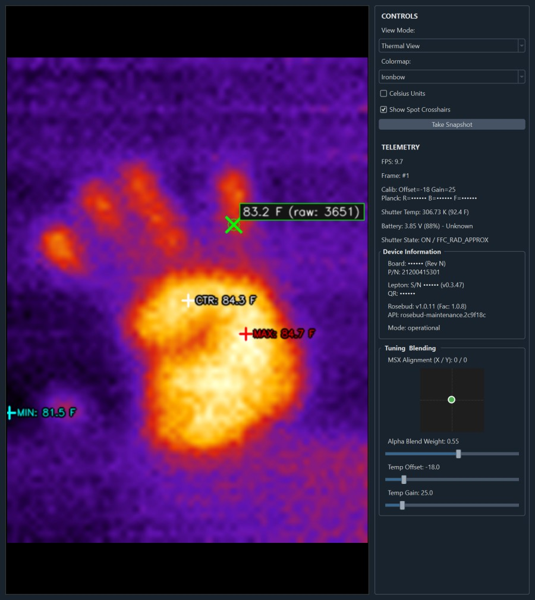
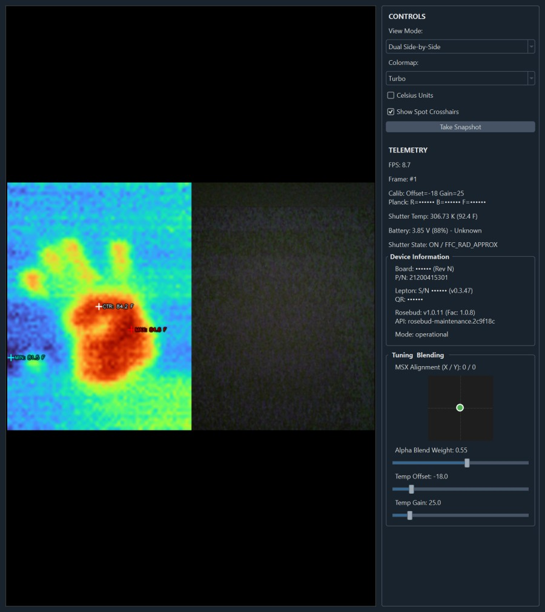
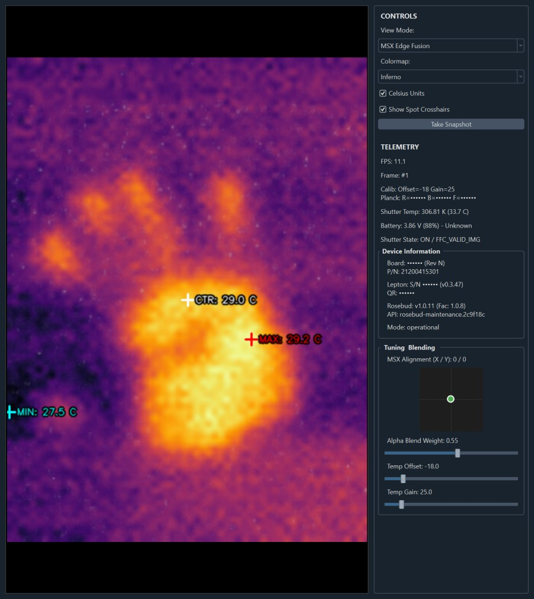
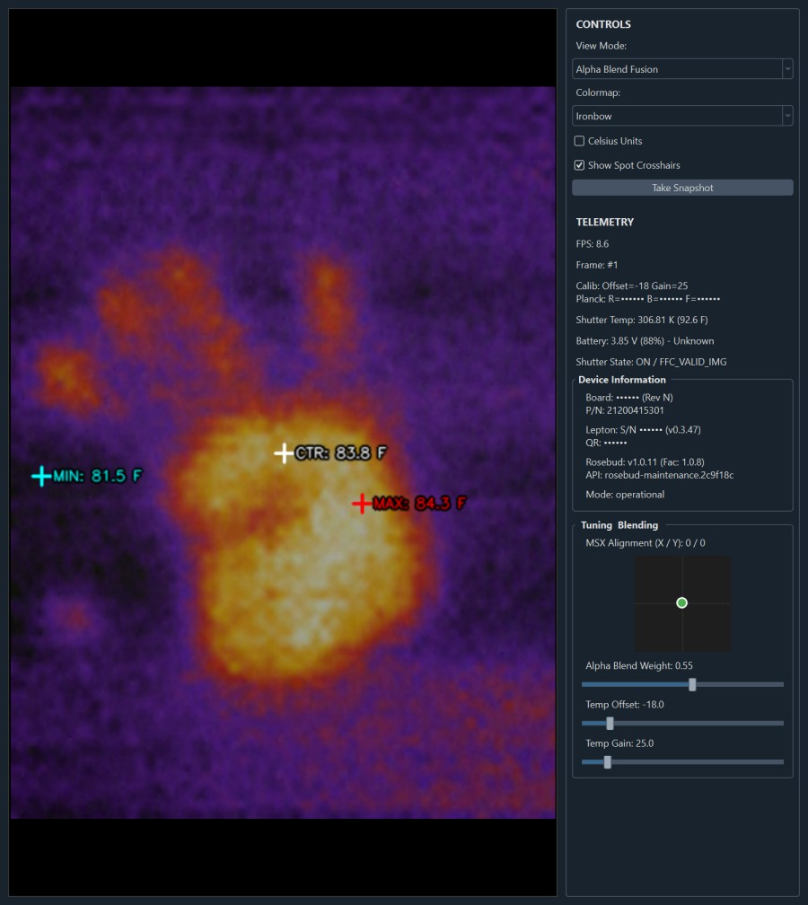
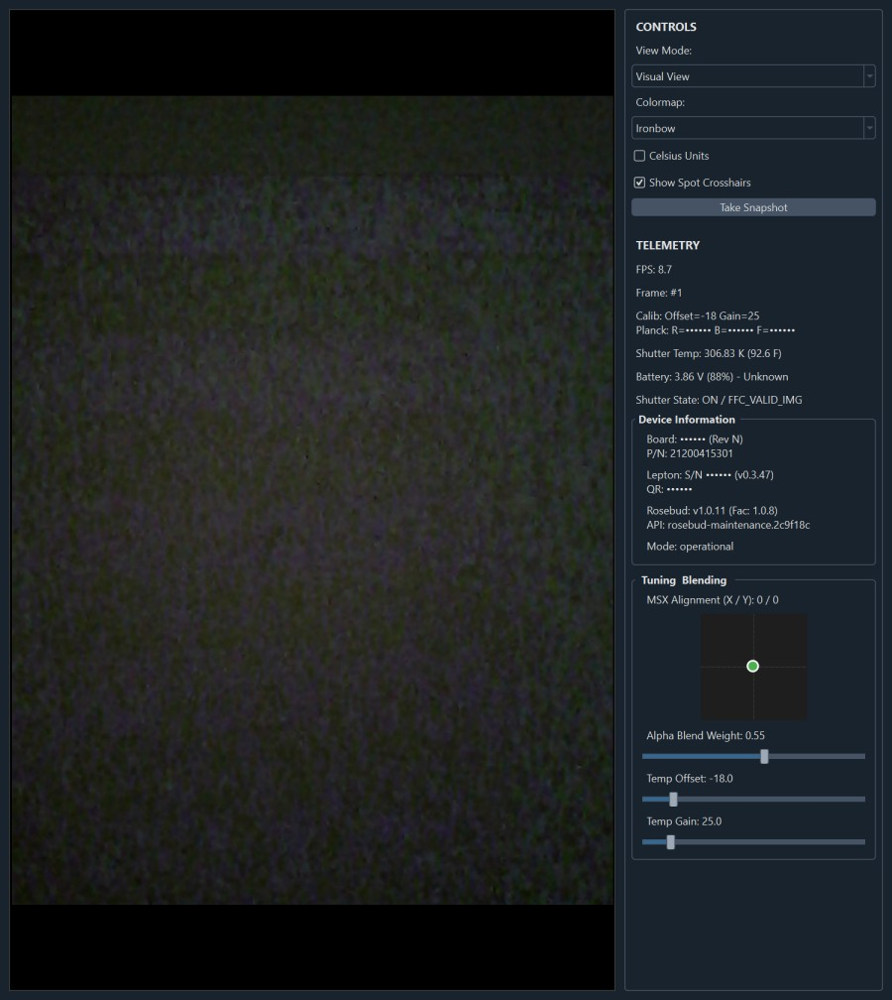
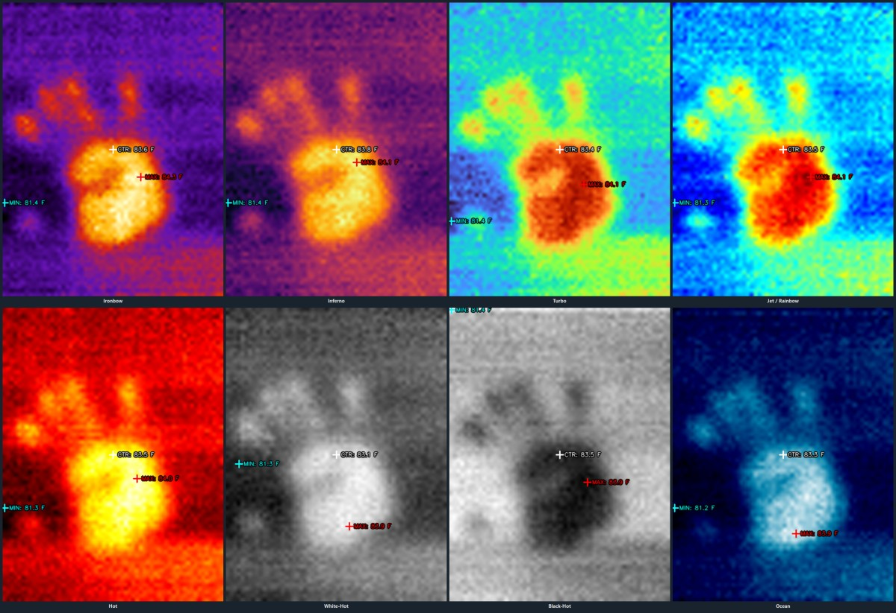

# RoseDud

**Bring a dead FLIR One (Gen 1) back to life as a USB thermal camera for your PC.**

RoseDud is a pure-USB Python client and PyQt6 viewer for the original **FLIR One (Gen 1)** thermal camera case (the iPhone 5/5s model from 2014). It speaks the device's own iAP2 / "Rosebud" protocol directly, so you need no iPhone, no iOS app, and no firmware changes. You only need a USB cable wired in place of its Lightning-style connector (see [§1](#1-hardware-modification)).

> **The name:** *Rosebud* was FLIR's internal codename for this product (`com.flir.rosebud.*`). The iPhone it was built for is long dead, which made the case a dud. RoseDud makes it useful again.

[](LICENSE) [](docs/LICENSE)

| Status | |
| :--- | :--- |
| Hardware | FLIR One **Gen 1** only (VID `09CB`, PID `1996`). The Gen 2 / Gen 3 / Pro models use a different protocol and will not work. |
| Windows | Tested (native WinUSB backend) |
| Linux / macOS | libusb backend included but **largely untested**; reports welcome |
| Temperatures | Approximate: an empirical calibration model, not validated against a blackbody (see [docs §8](docs/DEVICE_AND_SYSTEM_ARCHITECTURE.md#8-radiometric-temperature-conversion--optical-fusion)) |

<p align="center">
  
  <br>
  <sub>The warm print a hand left on a wall a few seconds earlier, seen through a Gen 1 case over USB. More in <a href="#screenshots">Screenshots</a>.</sub>
</p>

---

## Legal Disclaimer & Trademark Notice

> [!CAUTION]
> **Independent research and interoperability project.** This project, its documentation and its software are independent reverse-engineering and interoperability work, done for educational and research purposes and to keep working hardware out of landfill.
>
> * **Not affiliated:** The authors are **not** affiliated with, sponsored by, or endorsed by **FLIR Systems, Inc.**, **Teledyne FLIR LLC**, **Apple Inc.**, or any of their affiliates.
> * **Trademarks:** "FLIR", "FLIR ONE", "Lepton" and "MSX" are trademarks of FLIR Systems / Teledyne FLIR. "Apple", "iPhone", "Lightning" and "MFi" are trademarks of Apple Inc. All other names are the property of their respective owners. They are used here only to identify the hardware and for interoperability reference.
> * **No warranty:** Everything here is provided **"as is"**, without warranty of any kind. Opening the case and soldering to it can permanently damage it, short its lithium battery, or start a fire. You do this at your own risk.

---

## Why This Exists

The FLIR One Gen 1 is a case that an iPhone 5/5s slides into. It talked to the phone only over Lightning, using Apple's MFi **iAP2** protocol. The iOS app no longer runs on any current iPhone. The case itself, though, is a capable, self-contained embedded system:

* a **FLIR Lepton** 80×60 long-wave infrared microbolometer with a mechanical shutter for flat-field correction,
* a 640×480 **visible-light camera** for MSX-style edge fusion,
* an **Atmel AT91SAM9G25** ARM SoC running Linux from 128 MB of NAND,
* its own Li-ion battery and charger.

Replacing the Lightning-style connector with a USB cable and reproducing the iPhone's side of the protocol turns it into a reusable USB thermal camera.

---

## Hardware Hacking Quick Facts

| | |
| :--- | :--- |
| SoC | Atmel AT91SAM9G25 (ARM926EJ-S, 400 MHz, ARMv5TEJ) |
| Storage | 128 MB NAND: U-Boot, A/B updater and operational kernels (initramfs), JFFS2 calibration, legacy UBIFS |
| OS | Linux 2.6.39+, runs entirely from an initramfs in RAM |
| Thermal sensor | FLIR Lepton 1.x, 80×60, VoSPI over SPI and CCI over I²C |
| Visual sensor | Sonix SN9C28x USB bridge plus an OmniVision sensor, 640×480 JPEG |
| USB | High-Speed composite device `09CB:1996`: 3 vendor-specific interfaces (`0xFF/0xF0`), 512-byte bulk endpoints |
| UART console | **115200 8N1**, 3.3 V; U-Boot `bootdelay=1` |
| Root login | `root` / `indigo` |
| Firmware watchdog | Host must complete iAP2 identification within about **5 s** of the daemon starting |

> [!NOTE]
> The board layout diagrams in [`docs/images/`](docs/images/) (`device_layout.svg`, `device_layout_reverse.svg`) are unfinished. Lightning-side pad and UART pad locations are still to be added.

The full write-up covers the NAND map, U-Boot environment, daemons, `/tmp` IPC, iAP2 bytes on the wire, the Rosebud frame format and radiometry. It is in **[docs/DEVICE_AND_SYSTEM_ARCHITECTURE.md](docs/DEVICE_AND_SYSTEM_ARCHITECTURE.md)**.

---

## 1. Hardware Modification

The case's Lightning-style connector is replaced with a USB 2.0 cable carrying power (VBUS), ground and the two USB data lines (D+ and D−).

> [!NOTE]
> The exact wiring (which connector pads carry which signal, with photos) is still being documented and will be added to [docs §5.1](docs/DEVICE_AND_SYSTEM_ARCHITECTURE.md#51-usb-wiring). Until then, treat this as a summary, not step-by-step instructions.

* Keep the D+/D− section short and twisted: this is a 480 Mbit/s link.
* The case runs from its internal battery. Charge it through the micro-USB port on the bottom and turn the power switch **on** before connecting.

---

## 2. Install

Requires **Python 3.9+**.

```sh
pip install -r requirements.txt
```

| Package | Used for |
| :--- | :--- |
| `pyusb`, `libusb-package` | USB access on Linux/macOS (libusb backend) |
| `numpy` | Radiometric math |
| `opencv-python` | JPEG decoding, colormaps, edge fusion |
| `PyQt6` | GUI |
| `QDarkStyle` | Dark theme |

---

## 3. USB Driver Setup

The FLIR One is an Apple MFi accessory, so its interfaces are **vendor-specific** (class `0xFF`), not USB Video Class. No OS treats it as a webcam on its own.

### Windows (WinUSB via Zadig)
1. Connect the modified case and switch it on.
2. Run **[Zadig](https://zadig.akeo.ie/)** and enable **Options → List All Devices**.
3. You will see three entries for VID `09CB` / PID `1996`. Depending on the Windows version, they are named either `FLIR ONE Camera (Interface 0/1/2)` or by their interface strings: `iAP Interface`, `com.flir.rosebud.fileio`, `com.flir.rosebud.frame`.
4. Install **WinUSB** on **each of the three**:

| Interface | String | Endpoints | Device-interface GUID |
| :--- | :--- | :--- | :--- |
| **0 (MI_00)** | `iAP Interface` | `0x81` IN, `0x02` OUT | `{6CE7CB69-66E4-4333-9B2C-55CAF3B6DD9C}` |
| **1 (MI_01)** | `com.flir.rosebud.fileio` | `0x83` IN, `0x04` OUT | `{CC2D2161-A10F-43DB-8E4B-1F210840EF2B}` |
| **2 (MI_02)** | `com.flir.rosebud.frame` | `0x85` IN, `0x06` OUT | `{2B51B20E-23A3-43AD-B1B6-69AD1C1F6A44}` |

Windows remembers the binding, so you only do this once per USB port and device.

### Linux
No kernel driver claims the interfaces, so the libusb backend can use them directly. To run without root, add a udev rule:

```sh
echo 'SUBSYSTEM=="usb", ATTR{idVendor}=="09cb", ATTR{idProduct}=="1996", MODE="0666"' | sudo tee /etc/udev/rules.d/99-flirone-gen1.rules
sudo udevadm control --reload-rules && sudo udevadm trigger
```

---

## 4. Usage

```sh
python flir_app.py              # connect to the camera (falls back to mock mode if none is found)
python flir_app.py --mock       # synthetic stream, no hardware needed
python flir_app.py --debug      # verbose USB / iAP2 logging
python flir_app.py --calib path/to/calib.rsc --snapshot-dir path/to/output
```

`--calib` defaults to the `calib.rsc` next to `flir_app.py`. Snapshots default to `snapshots/` next to it.

`calib.rsc` is not included in this repository: it is FLIR's factory file and is specific to each unit. You can copy your own from the device's JFFS2 calibration partition (see [docs §3](docs/DEVICE_AND_SYSTEM_ARCHITECTURE.md#3-128-mb-nand-flash-breakdown--memory-architecture) and [§8.2](docs/DEVICE_AND_SYSTEM_ARCHITECTURE.md#82-planck-constants-calibrsc)). Without it, the app falls back to built-in defaults.

### Features
* **View modes:** Thermal, Visual, Dual side-by-side, MSX-style edge fusion (a Laplacian edge overlay), and Alpha blend.
* **Palettes:** Ironbow, Inferno, Turbo, Jet, Hot, White-Hot, Black-Hot, Ocean.
* **Spot metering:** hover readout plus automatic min, max and center markers. Readings are in °F by default; tick *Celsius Units* to switch.
* **Shutter calibration:** when prompted, slide the shutter closed and hold it until the banner turns green, then release it. The app re-estimates its offset from the shutter temperature (see [docs §8.4](docs/DEVICE_AND_SYSTEM_ARCHITECTURE.md#84-shutter-based-offset-calibration-ffc)).
* **Tuning:** an XY pad for visual/thermal parallax alignment, alpha weight, and manual offset and gain sliders.
* **Telemetry:** battery voltage, charge and charging state; shutter state and temperature; board, Lepton and firmware versions.
* **Snapshots:** each one saves a thermal °C matrix (`.csv`), a colorized thermal image (`.png`) and the visual frame (`.jpg`).

### Screenshots

All taken on real hardware. Device serial numbers are masked.

| Dual side-by-side (Turbo) | MSX-style edge fusion (Inferno, °C) |
| :---: | :---: |
|  |  |
| **Alpha blend (Ironbow)** | **Visual camera** |
|  |  |

**All eight palettes:**



---

## 5. Troubleshooting

| Symptom | Fix |
| :--- | :--- |
| `No USB backend available` / `Failed to connect` | Windows: WinUSB is not installed on all three interfaces (see §3). Linux: check the udev rule and `lsusb \| grep 09cb`. |
| `iAP2 link handshake timed out` | The 5-second firmware watchdog expired before identification finished. Power-cycle the case and start the app straight away. |
| Stream starts, then freezes after a few frames | The EP `0x83` FileIO endpoint is not being drained (see [docs §6.5](docs/DEVICE_AND_SYSTEM_ARCHITECTURE.md#65-preventing-pipeline-stalls-draining-ep-0x83)). The app does this itself and reconnects after 5 s without frames. If it keeps happening, run with `--debug` and open an issue. |
| Temperatures look offset | Hold the shutter closed until the banner turns green, or adjust *Temp Offset*. |
| Thermal and visual views don't line up | Drag the MSX alignment XY pad; right-click it to reset. |

---

## 6. Repository Layout

```
.
├── README.md                 # This file
├── LICENSE                   # GPL-3.0 (code)
├── requirements.txt
├── docs/
│   ├── LICENSE               # CC BY-SA 4.0 (documentation and diagrams)
│   ├── DEVICE_AND_SYSTEM_ARCHITECTURE.md   # Hardware, NAND, firmware and protocol reference
│   └── images/               # Board layout diagrams (work in progress) and README screenshots
├── flir_app.py               # PyQt6 viewer (entry point)
├── flir_usb.py               # Streamer: transport selection, worker, drain and watchdog threads, mock stream
├── winusb_backend.py         # Native Windows WinUSB backend (ctypes, overlapped I/O)
├── libusb_backend.py         # PyUSB / libusb backend (Linux / macOS)
├── iap2.py                   # iAP2 link-layer framing and handshake state machine
├── flir_protocol.py          # Rosebud 0xBEEF frame parser and VoSPI unpacker
├── flir_calib.py             # calib.rsc parser, Planck conversion, shutter FFC
└── tests/                    # pytest suite (runs headless, no hardware needed)
```

### Running the tests
```sh
pip install pytest
python -m pytest tests
```

---

## 7. Contributing

Bug reports, hardware photos and test results from other units (especially on Linux and macOS) are very welcome. The open problems are listed in [docs §9](docs/DEVICE_AND_SYSTEM_ARCHITECTURE.md#9-open-questions--ideas-for-contributors): factory fusion alignment, telemetry decoding, proper radiometric calibration, and a UVC firmware port.

---

## License

* **Code** (all `.py` files and the tests) is licensed under the **[GNU General Public License v3.0 or later](LICENSE)** (GPL-3.0-or-later). You may use, modify and redistribute it, commercially or not, but if you distribute it or a modified version, you must make the full source available under the same license.
* **Documentation and diagrams** (everything in `docs/`, plus this README) are licensed under **[Creative Commons Attribution-ShareAlike 4.0 International](docs/LICENSE)** (CC BY-SA 4.0). Credit this project when you share or adapt them, and share adaptations under the same license.

Both licenses provide the software and documentation **without any warranty**.

**Request from the author (not a license term):** please do not use this work, or anything derived from it, for military or weapons purposes.
