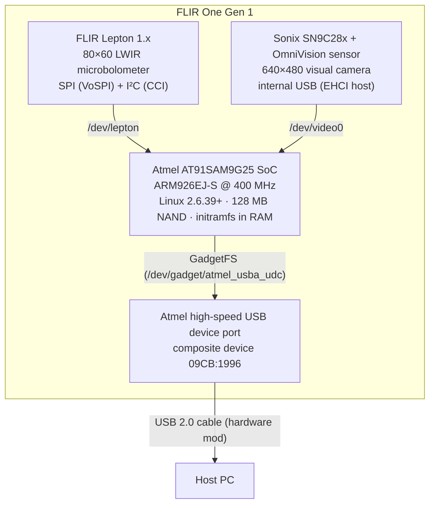
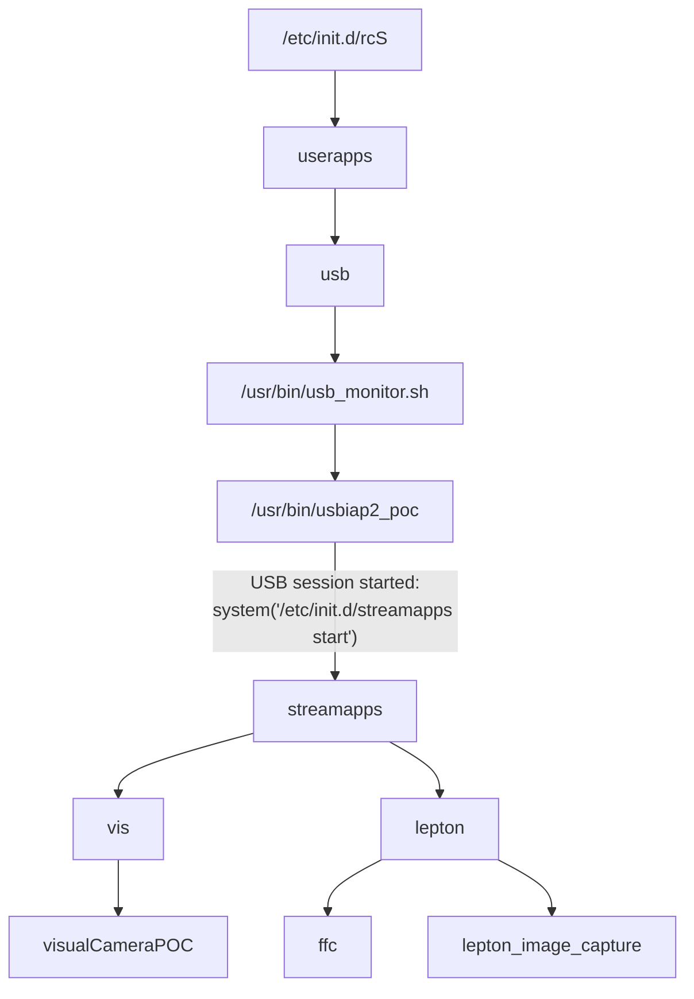

# RoseDud Technical Reference: FLIR One (Gen 1) Hardware, Firmware & USB Protocol

This document provides a comprehensive, fact-based technical breakdown of the original **FLIR One (Gen 1)** thermal camera case (iPhone 5/5s form factor), its embedded hardware and 128 MB NAND flash memory map, the CPU daemons and internal `/tmp` IPC architecture, and how the device was reverse-engineered to stream live radiometric thermal and visual video over a direct USB connection to a PC.

---

## Legal Disclaimer & Trademark Notice

> [!CAUTION]
> **Independent Research & Interoperability Disclaimer**:
> This project, its documentation, and associated software are independent research, reverse-engineering, and interoperability efforts conducted strictly for educational, research, and electronic waste (e-waste) reduction purposes.
>
> * **No Representation or Affiliation**: The authors and contributors of this repository are **not** affiliated with, associated with, sponsored by, authorized by, or endorsed by **FLIR Systems, Inc.**, **Teledyne FLIR LLC**, **Apple Inc.**, or any of their subsidiaries, parent companies, or affiliates. The author does **not** represent FLIR Systems or Teledyne FLIR in any capacity.
> * **Trademarks**: "FLIR", "FLIR ONE", "Lepton", and "MSX" are registered trademarks or trademarks of FLIR Systems / Teledyne FLIR. "Apple", "iPhone", "Lightning", and "MFi" are registered trademarks of Apple Inc. All other product names, logos, brands, and registered trademarks mentioned within this documentation and repository are the property of their respective owners. Their use here is strictly for identification, historical context, and technical interoperability reference under fair use doctrine.
> * **No Warranty / As-Is**: All information, schematics, pinouts, and code are provided **"as is"** without warranty of any kind, express or implied, including but not limited to the warranties of merchantability, fitness for a particular purpose, and non-infringement. Modifying hardware (including cutting or soldering connectors) carries inherent risks, including permanent device damage, electrical short circuits, or battery fire. The author assumes no liability or responsibility for any damages, hardware failure, injury, or legal consequences resulting from following or applying this research.

---

## 1. System Overview & Hardware Architecture

The FLIR One (Gen 1) — internal project codename **Rosebud** (`/etc/device.info`: form factor `dongle`) — is a case-style dual-camera accessory: an iPhone 5 or 5s slides into it and connects through a Lightning-style connector.

> **Terminology:** FLIR's firmware and protocol call the device the "sled" (for example the `sledInformation` message and `RBProtocol_sled_*` functions), so that word appears in identifiers and in RoseDud's code. This document calls it the case.



### Core Hardware Components
* **SoC / Main Processor**: Atmel **AT91SAM9G25** (ARM926EJ-S core running at 400 MHz, ARM 32-bit Little Endian, ARMv5TEJ instruction set).
* **Thermal Core**: FLIR **Lepton 1.x** ($80 \times 60$ uncooled long-wave infrared microbolometer, $8\text{--}14\,\mu\text{m}$ spectral response):
  * **Video Transport**: Video over SPI (**VoSPI**) connected to Atmel SPI bus via kernel driver `extra/lepton.ko` (`/dev/lepton`, slave select GPIO 47 `/ss_lepton`).
  * **Command & Control Interface (CCI)**: I2C bus `/dev/i2c-0` for shutter commands, telemetry, and radiometry configuration.
  * **GPIO Control**: Dedicated GPIOs 48–50 for sensor power and hardware reset.
  * **Shutter**: Manual, spring-loaded sliding shutter. Sliding it with a finger (usually the index finger while holding the case) closes it over the thermal lens; releasing it lets it spring back open. While it is held closed it gives the sensor a uniform reference for Flat-Field Correction (FFC).
* **Visible Camera**: Sonix **SN9C28x** USB image processor controller (USB VID/PID `0c45:6369`) paired with an OmniVision CMOS sensor:
  * Interfaced to the SoC via an internal Atmel USB 2.0 EHCI host controller (`ehci_hcd`).
  * Exposed to userspace via the Linux Video4Linux2 subsystem as `/dev/video0`.
* **USB Peripheral Controller**: Atmel High-Speed USB Device Port (`atmel_usba_udc`), operating in device mode and driven by the Linux **GadgetFS** driver framework (`/dev/gadget/atmel_usba_udc`).
* **Power Subsystem**: Internal rechargeable lithium-ion battery with an I²C fuel gauge and charger (monitored by `battery_charge`), rechargeable via the micro-USB port on the bottom of the case or via incoming $V_{BUS}$.

---

## 2. Original Operational Model (iOS MFi Accessory)

In its factory configuration, the case connected to an iPhone 5/5s through a Lightning connector. It operated under the Apple **MFi** (Made for iPhone) program:

### USB Device Descriptor
* **Vendor ID (VID)**: `0x09CB` (*FLIR Systems*)
* **Product ID (PID)**: `0x1996` (*FLIR ONE Camera*)
* **Device Class**: `0x00` (Defined at interface level) / Subclass `0x00` / Protocol `0x00`
* **Device Release**: `bcdDevice 0x0108` (v1.8)
* **Speed / Power**: USB 2.0 High-Speed, self-powered (`bmAttributes 0xC0`, `bMaxPower` 0 mA)
* **Serial Number String**: `FLIRONE` + the board serial number (unique per unit)

### Composite Interface and Endpoint Architecture
The device registers 3 composite USB interfaces. Every interface is Vendor-Specific class `0xFF`, subclass `0xF0`, and every endpoint is Bulk with `wMaxPacketSize` 512 bytes:

| Interface | String Descriptor | AltSettings | Endpoints (alt 1 unless noted) | Function |
| :--- | :--- | :--- | :--- | :--- |
| **0 (MI_00)** | `iAP Interface` | `0` only | **EP `0x81` IN**, **EP `0x02` OUT** (alt 0) | Apple **iAP2** link layer: link sync, identification, External Accessory session negotiation, JSON status messages. |
| **1 (MI_01)** | `com.flir.rosebud.fileio` | `0` (no endpoints), `1` | **EP `0x83` IN**, **EP `0x04` OUT** | FileIO session: status/file messages. **Must be drained continuously** (see §6.5). |
| **2 (MI_02)** | `com.flir.rosebud.frame` | `0` (no endpoints), `1` | **EP `0x85` IN**, **EP `0x06` OUT** | Frame streaming session: combined thermal + visual + metadata Rosebud packets. |

AltSetting 0 on interfaces 1 and 2 is the zero-bandwidth idle state; selecting AltSetting 1 is what tells the firmware a session has started (this is the iAP2 "External Accessory native transport" model).

---

## 3. 128 MB NAND Flash Breakdown & Memory Architecture

The onboard storage is a 128 MB NAND flash chip. A raw 128 MiB dump of the data area (no OOB/spare bytes) was analyzed with unblob/binwalk; the offsets below are as found in that dump. It reveals an A/B dual-boot architecture:

### 128 MB NAND Flash Memory Map

| Hex Offset Range | Decimal Byte Range | Size | Partition Name / Content |
| :--- | :--- | :--- | :--- |
| `0x00000000 - 0x00200000` | `0 - 2,097,152` | 2.0 MB | **U-Boot Bootloader & Environment** |
| `0x00200000 - 0x00E00000` | `2,097,152 - 14,680,064` | 12.0 MB | **Updater Kernel Slot 1** (`kern_up1`) |
| `0x00E00000 - 0x01A00000` | `14,680,064 - 27,262,976` | 12.0 MB | **Operational Kernel Slot 1** (`kern_op1`) |
| `0x01A00000 - 0x02600000` | `27,262,976 - 39,845,888` | 12.0 MB | **Updater Kernel Slot 2** (`kern_up2` - Redundant A/B) |
| `0x02600000 - 0x03200000` | `39,845,888 - 52,428,800` | 12.0 MB | **Operational Kernel Slot 2** (`kern_op2` - Redundant A/B) |
| `0x03210000 - 0x0323842D` | `52,494,336 - 52,659,245` | ~164 KB | **JFFS2 Calibration & Manufacturing Data** |
| `0x04010000 - 0x04194106` | `67,174,400 - 68,763,910` | 1.52 MB | **Factory Kernel** (UBIFS bootloader) |
| `0x04C00000 - 0x07F00000` | `79,691,776 - 133,169,152` | 51.0 MB | **UBI / UBIFS Root Filesystem (July 2014 Dev Build)** |
| `0x07F00000 - 0x08000000` | `133,169,152 - 134,217,728` | 1.0 MB | **Reserved / Bad Block Table (BBT)** |

### U-Boot Environment Configuration (`0x160000`)
The bootloader environment variables govern the redundant boot execution:

```sh
bootcmd=dcache on ; if chk_flash_enable ; then run boot_up ; else run boot_op ; run boot_up ; fi
bootdelay=1
baudrate=115200
autostart=yes
watchdog=1
kern_op1=0x0e00000
kern_op2=0x2600000
kern_up1=0x0200000
kern_up2=0x1a00000
boot_op=echo boot operational;nboot 0x22000000 0 ${kern_op1};nboot 0x22000000 0 ${kern_op2}
boot_up=echo boot updater;mw 0x20000000 0xdeadbeef 0xe3c000;nboot 0x22000000 0 ${kern_up1}; nboot 0x22000000 0 ${kern_up2}
flash_enable=1
```

### Critical Architectural Finding: Initramfs vs. UBIFS
A pivotal discovery from reverse-engineering the flash dump resolved why filesystem binaries differed across partitions:

1. **Production Runs Entirely from RAM (Initramfs)**:
   * The production system does **not** mount the 51 MB UBIFS partition at runtime.
   * Instead, the active operational kernels (`kern_op1/2`) and updater kernels (`kern_up1/2`) are self-contained `uImage` files (built **May 12, 2015**, Linux 2.6.39+).
   * Each kernel unpacks an internal **CPIO initramfs** into RAM and executes exclusively out of memory.
   * All functional production binaries (`usbiap2_poc`, `visualCameraPOC`, `lepton_image_capture`, `battery_charge`, `ffc`, `mp_test`) reside within this CPIO initramfs.

2. **The 51 MB UBIFS Partition is an Obsolete July 2014 Dev Build**:
   * The UBIFS partition on flash is an older engineering build (`version.txt`: `unreleased-auto-svn5279 20140711-20:23:55`).
   * It contains developer utilities (`gdb` 2.7 MB, `vim` 1.1 MB, `strace`).
   * Crucially, the daemons stored in UBIFS were written with sparse blocks on physical flash (e.g., the 1.4 MB debug `usbiap2_poc` had only 24 KB of actual non-zero code).
   * The **May 2015 Initramfs binaries** are 100% complete, intact, and operational:
     * `usbiap2_poc`: **210,188 bytes** (vs 1.4 MB incomplete in UBIFS)
     * `visualCameraPOC`: **26,584 bytes** (vs 625 KB incomplete in UBIFS)
     * `lepton_image_capture`: **10,196 bytes** (vs 23.8 KB in UBIFS)
     * `battery_charge`: **39,156 bytes** (vs 76.7 KB in UBIFS)
     * `ffc`: **18,772 bytes** (vs 48.1 KB in UBIFS)

3. **Factory Kernel**:
   * The Factory Kernel at `0x04010000` is the sole kernel configured with `root=ubi0:rootfs atmel_nand.use_dma=0` to boot the UBIFS partition for initial factory provisioning.

---

## 4. Internal CPU Daemons, Process Model & `/tmp` IPC Architecture

The device executes a coordinated pipeline of userspace daemons communicating through an atomic file-backed IPC mechanism staged in `/tmp` (RAM disk).

### Boot Sequence and Process Hierarchy


### The `/tmp` IPC Layout
Rather than UNIX sockets or shared memory, the daemons pass image frames and telemetry by writing to staging files and performing atomic `rename` operations within `/tmp`:

| Path | Writer Daemon | Reader Daemon | Content / Description |
| :--- | :--- | :--- | :--- |
| `/tmp/unsync/ir` | `lepton_image_capture` | `visualCameraPOC` | Latest raw Lepton frame. Written to `/tmp/.ir.tmp` and atomically renamed to `/tmp/unsync/ir`. |
| `/tmp/unsync/ts/timestamp` | `lepton_image_capture` | `visualCameraPOC` | Frame timing metadata (frame counter, high-res timespec, capture period). |
| `/tmp/readyvis/vis` | `visualCameraPOC` | `usbiap2_poc` | Combined visual JPEG + thermal frame buffer ready for USB transmission. |
| `/tmp/ffc` | `ffc` | `usbiap2_poc` | 64-byte ASCII calibration status record. Written to `/tmp/ffc.tmp` and renamed. |
| `/tmp/shutter` | kernel / userspace | `usbiap2_poc` | Shutter position (`open` / `closed`). |
| `/tmp/versions` | system scripts | `usbiap2_poc` | Device firmware and library version strings. |
| `/tmp/streaming_status` | `streamapps` | `usbiap2_poc` | Mutual-exclusion streaming lock flag. |
| `/tmp/vis.error` | `vis_monitor.sh` | diagnostics | Hardware disconnect/error logs for the Sonix USB camera. |
| `/root/shared_files/manufacturing_data.txt` | factory / JFFS2 | `usbiap2_poc` | Serial numbers and hardware IDs reported during iAP2 identity query. |

---

### Detailed Analysis of Key Production Daemons

#### 1. `lepton_image_capture` (Thermal Acquisition Daemon)
* **Binary Path**: `/usr/bin/lepton_image_capture` (10,196 bytes)
* **Interface**: Connects to `/dev/lepton` via the `extra/lepton.ko` kernel module.
* **Frame Size**: Reads exactly **10,332 bytes** per thermal frame:
  * Composed of **63 VoSPI packets** of **164 bytes** each ($63 \times 164 = 10{,}332$ bytes).
  * Packets 0–59: 60 image lines ($80 \text{ pixels} \times 2 \text{ bytes} = 160$ bytes payload + 4 bytes header). Total raw image is 9,840 bytes.
  * Packets 60–62: 3 lines of Lepton telemetry data (internal FPA temperature, housing temperature, frame count).
* **Operation Loop**:
  * Paced using Linux high-resolution timer file descriptors (`timerfd_create` and `lepton_timerfd_expire`).
  * On receiving a complete VoSPI buffer, writes to `/tmp/.ir.tmp`, performs an atomic `rename` to `/tmp/unsync/ir`, and updates `/tmp/unsync/ts/timestamp`.
* **RE-assigned function names (not original symbols)**: `lepton_main`, `lepton_read_frame`, `lepton_save_frame_atomic`, `lepton_timerfd_expire`.

#### 2. `visualCameraPOC` (Visual Capture & Synchronization)
* **Binary Path**: `/usr/bin/visualCameraPOC` (26,584 bytes)
* **Interface**: Connects to the Sonix camera controller (`0c45:6369`) via V4L2 device `/dev/video0`.
* **Launch Arguments**: Invoked by init scripts with:
  ```sh
  visualCameraPOC -fm -s 100000 -o 15000000
  ```
  * `-fm`: Frame mode operation.
  * `-s 100000`: Sleep interval ($100\,\text{ms}$).
  * `-o 15000000`: Hardware synchronization offset ($15\,\text{ms}$).
* **Operation Loop**:
  * Captures $640 \times 480$ JPEG visual frames via V4L2 streaming buffers (`vis_read_frame`).
  * Polls `/tmp/unsync/ts/timestamp` to correlate the visual frame with the most recent Lepton IR frame.
  * Concatenates the IR buffer and visual JPEG into `/tmp/readyvis/vis` via atomic rename (`vis_save_file_atomic`).
  * **File Structure**: In `/tmp/readyvis/vis`, the raw visual JPEG begins exactly at byte offset **10,364** (verified via `dd skip=10364`).
* **RE-assigned function names (not original symbols)**: `vis_main`, `vis_read_frame`, `vis_build_composite_frame`, `vis_save_file_atomic`, `vis_v4l2_ioctl_retry`.

#### 3. `ffc` (Flat-Field Correction & Radiometry Daemon)
* **Binary Path**: `/usr/bin/ffc` (18,772 bytes)
* **Configuration**: Parses `/etc/ffc.cfg` into an 84-byte `ffc_config_t` structure.
* **Interface**: Lepton Command & Control Interface over `/dev/i2c-0` (`lep_i2c_*` / `lep_cci_*`).
* **State Machine**:
  * Tracks calibration states: `FFC_INVALID`, `FFC_PROGRESS`, `FFC_RAD_APPROX`, `FFC_RAD_VALID`, `FFC_VALID_IMG`, and `FFC_DESIRED`.
  * Runs the Lepton's radiometric FFC (`LEP_RunRadFFC`) to normalize pixel drift across the microbolometer array. The shutter is manual, so this relies on the user holding it closed; the `FFC_DESIRED` state appears to be the firmware's request for that.
  * Publishes a 64-byte ASCII status record to `/tmp/ffc.tmp` and renames to `/tmp/ffc`.
* **RE-assigned function names (not original symbols)**: `ffc_main`, `ffc_load_config`, `ffc_publish_state`, `lep_init_radiometry_calibration`, `LEP_RunRadFFC`, `lep_read_temperature_cK`.

#### 4. `usbiap2_poc` (Apple iAP2 & USB Streaming Daemon)
* **Binary Path**: `/usr/bin/usbiap2_poc` (210,188 bytes)
* **Role**: Primary communication bridge interfacing Linux GadgetFS with the host.
* **Watchdog Mechanism**: Starts an internal **5-second watchdog timer** upon boot. If a host does not initiate an iAP2 session and send identification within 5 seconds, the watchdog triggers a process reset or restarts `streamapps`.
* **Frame Streaming Thread (`eap_frame_thread_body`)**:
  * Sets an `inotify` watch on `/tmp/readyvis/vis`.
  * Wakes on file change, reads `/tmp/readyvis/vis`, `/tmp/ffc`, `/tmp/shutter`, and `/tmp/versions`.
  * Prepend the 28-byte Rosebud packet header (`0x0000BEEF`).
  * Transmits the packet over **EP `0x85` Bulk IN**.
* **RE-assigned function names (not original symbols)**: `usbiap_main`, `iAP2LinkRunLoopRun`, `eap_frame_thread_body`, `RBProtocol_sled_enqueueImageFrame`, `handle_eap_command_data`.

#### 5. `battery_charge` (Power Management)
* **Binary Path**: `/usr/bin/battery_charge` (39,156 bytes)
* **Role**: Communicates over I2C with the battery fuel gauge IC; polls state of charge, voltage, and charging status.

---

## 5. Hardware Access

### 5.1 USB Wiring
The case originally connected to the iPhone through a Lightning-style connector. To talk to a PC, that connection is replaced with a USB 2.0 cable carrying power (VBUS), ground, and the two USB data lines (D+ and D−).

> **TODO:** The exact wiring (which connector pads or test points carry which signal, with photos) is still being worked out and will be added here and to `docs/images/`. Until then, treat this section as a summary, not instructions.

Notes:
* The case reports itself as **self-powered** (0 mA in the descriptor) and runs from its internal Li-ion battery; host $V_{BUS}$ can also charge it. Keep the battery charged (micro-USB port on the bottom) and the power switch on.
* D+/D− are a high-speed (480 Mbit/s) pair: keep any unshielded section short and the two wires twisted together.
* When powered, the SoC boots Linux from NAND into RAM; the composite device enumerates once `usbiap2_poc` has started (a few seconds).

### 5.2 UART Serial Console
The SoC exposes a debug UART: the U-Boot prompt, then a password-protected Linux login (root password below). It is the most useful access point for exploring the firmware.

| Setting | Value |
| :--- | :--- |
| Baud / framing | **115200 8N1**, no flow control |
| Logic level | 3.3 V (AT91SAM9G25 I/O) — **do not** connect a 5 V or RS-232 adapter |
| Bootloader | U-Boot, `bootdelay=1` — press a key within 1 s of power-on to get the U-Boot prompt |
| Linux login | user `root`, password `indigo` |

> **TODO:** UART TX / RX / GND pad locations with a photo — add to `docs/images/`.

Useful at the U-Boot prompt:
* `printenv` — dumps the environment shown in §3 (stored at NAND offset `0x160000`).
* `nboot 0x22000000 0 0x0e00000` — load and boot a specific kernel slot by hand (`kern_op1` here; `autostart=yes` boots it right after loading). See the memory map for the other slots.
* `bootcmd` runs `chk_flash_enable`: if the flash-enable flag is set it boots the **updater** kernels (`boot_up`), otherwise the **operational** kernels (`boot_op`), falling back to the updater if both operational slots fail.

Useful in the Linux shell:
* `ls /tmp` — watch the IPC files from §4 (`/tmp/ffc`, `/tmp/shutter`, `/tmp/readyvis/vis`) change while streaming.
* `/etc/init.d/streamapps start` — start the capture daemons by hand.
* The root filesystem is an initramfs in RAM: changes are lost at reboot.

---

## 6. USB Bring-up: How the PC Host Talks to the Device

### 6.1 Host Driver Binding
* **Windows**: the interfaces are Vendor-Specific (`0xFF`), so Windows binds only the generic composite parent (`usbccgp`). Use **Zadig** to bind **WinUSB** to each of the three child interfaces (MI_00, MI_01, MI_02). `winusb_backend.py` then opens each one by its device-interface GUID (listed in the README).
* **Linux**: no kernel driver claims the interfaces, so `libusb_backend.py` (PyUSB) can claim them directly. You only need a udev rule for non-root access (see the README).

### 6.2 Beating the 5-Second Firmware Watchdog
`usbiap2_poc` starts a 5-second timer when it boots. If no host completes iAP2 identification within that window, the daemon resets its session, and the handshake has to be retried (power-cycling the device always works). The host therefore starts the handshake as soon as interface 0 can be opened (`WinUsbTransport.connect` retries the open every 100 ms).

### 6.3 iAP2 Link Packets
Every packet on EP `0x02` / `0x81` uses the iAP2 link-layer framing (`iap2.make_iap2_packet` / `parse_iap2_packet`):

```
FF 5A  LEN_HI LEN_LO  CTRL  SEQ  ACK  SESSION  HDR_CHK  [PAYLOAD ...  PAYLOAD_CHK]
```

* `LEN` = total packet length: 9 header bytes + payload + 1 payload checksum byte (no payload → `LEN = 9` and no payload checksum).
* `CTRL`: `0x80` = SYN, `0x40` = ACK; `0xC0` = SYN+ACK.
* Checksums are two's complement: the header bytes (including `HDR_CHK`) sum to 0 mod 256, and so do the payload bytes plus `PAYLOAD_CHK`.
* Control-session payloads start with `40 40`, a 2-byte length, and a 2-byte message ID, followed by parameters, each as `LEN(2) ID(2) DATA`.

### 6.4 Handshake Sequence (exact bytes)
1. **Link detect**: the host sends `FF 55 02 00 EE 10`, and repeats it until the device answers.
2. **SYN**: the device sends a packet with `CTRL=0x80` carrying its link parameters.
3. **SYN-ACK**: the host echoes the same link-parameter payload back with `CTRL=0xC0`, `SEQ=0`, `ACK=<device seq>`.
4. **Identification `0x1D02`**: the host sends payload `40 40 00 06 1D 02` on session 1. This is the message that cancels the 5-second watchdog.
5. The device replies with a **`0xAE00`** message, which the host ACKs, and then a **`0xAE03`** message, which is the cue to open the command session.
6. **StartExternalAccessoryProtocolSession `0xEA00`**: the host sends
   `40 40 00 11 EA 00  00 05 00 00 00  00 06 00 01 00 01`
   (parameter 0 = protocol `0`, `com.flir.rosebud.config`; parameter 1 = session ID `1`).
7. **Activate the bulk sessions** with standard `SET_INTERFACE` control transfers on EP0 (`bmRequestType 0x01`, `bRequest 0x0B`):
   * `SET_INTERFACE(interface=1, alt=1)`: the firmware marks its `SLED` link up and starts sending on EP `0x83`.
   * `SET_INTERFACE(interface=2, alt=1)`: the firmware runs `/etc/init.d/streamapps start` and begins pushing frames on EP `0x85`.

`0xEA00` messages for protocols 1 and 2 also exist (`build_start_fileio_session_message`, `build_start_frame_session_message`), but they are **not needed**: `SET_INTERFACE` alone activates those sessions.

After step 6 the host ACKs every data packet. The device then sends JSON status messages on the control session (§6.6).

### 6.5 Preventing Pipeline Stalls: Draining EP `0x83`
The single most important rule for a stable stream:
* After `SET_INTERFACE(1,1)`, the firmware keeps writing status and file messages to the FileIO endpoint (EP `0x83` IN).
* If the host reads only the frame endpoint (EP `0x85`), the EP `0x83` gadget buffer fills, `usbiap2_poc` blocks on `write()`, and **frame streaming stalls**.
* Fix: `flir_usb.py` runs a background thread that reads and discards EP `0x83` every 100 ms. A second watchdog reconnects if no frame arrives for 5 s.

### 6.6 JSON Messages on the Control Session
Once the command session is up, the device sends UTF-8 JSON objects of the form `{"type": ..., "data": {...}}` inside iAP2 payloads. The ones seen so far:

| `type` | `data` fields |
| :--- | :--- |
| `batteryVoltageUpdate` | `voltage` (V), `percentage` |
| `batteryChargingCurrentUpdate` | `chargingCurrent` (mA) |
| `batteryChargingStateUpdate` | `chargingState` (`stateNoCharging`, `stateManagedBatteryCharging`, …) |
| `sledInformation` | `serialNumberBoard`, `partNumberBoard`, `versionBoard`, `serialNumberLepton`, `versionLepton`, `leptonQR`, `versionRosebudFactoryESW`, `versionRosebudOperationalESW`, `versionRosebudUpdaterESW`, `versionRosebudAPI`, `gitRevision`, `operatingMode` |

---

## 7. Rosebud Frame Packet Specification (`0x0000BEEF`)

Every frame transmitted over **Endpoint `0x85` Bulk IN** conforms to the proprietary FLIR **Rosebud** framing protocol:

### 28-Byte Frame Header (Little-Endian)

```
 0                   1                   2                   3
 0 1 2 3 4 5 6 7 8 9 0 1 2 3 4 5 6 7 8 9 0 1 2 3 4 5 6 7 8 9 0 1
+-+-+-+-+-+-+-+-+-+-+-+-+-+-+-+-+-+-+-+-+-+-+-+-+-+-+-+-+-+-+-+-+
|                      Magic (0x0000BEEF)                       |
+-+-+-+-+-+-+-+-+-+-+-+-+-+-+-+-+-+-+-+-+-+-+-+-+-+-+-+-+-+-+-+-+
|                       Frame Sequence Index                    |
+-+-+-+-+-+-+-+-+-+-+-+-+-+-+-+-+-+-+-+-+-+-+-+-+-+-+-+-+-+-+-+-+
|                       Total Payload Length                    |
+-+-+-+-+-+-+-+-+-+-+-+-+-+-+-+-+-+-+-+-+-+-+-+-+-+-+-+-+-+-+-+-+
|                       Thermal Image Length                    |
+-+-+-+-+-+-+-+-+-+-+-+-+-+-+-+-+-+-+-+-+-+-+-+-+-+-+-+-+-+-+-+-+
|                       Visual Image Length                     |
+-+-+-+-+-+-+-+-+-+-+-+-+-+-+-+-+-+-+-+-+-+-+-+-+-+-+-+-+-+-+-+-+
|                       Metadata Length                         |
+-+-+-+-+-+-+-+-+-+-+-+-+-+-+-+-+-+-+-+-+-+-+-+-+-+-+-+-+-+-+-+-+
|                       Header CRC-32                           |
+-+-+-+-+-+-+-+-+-+-+-+-+-+-+-+-+-+-+-+-+-+-+-+-+-+-+-+-+-+-+-+-+
```

| Byte Offset | Field Name | Data Type | Value / Description |
| :--- | :--- | :--- | :--- |
| `0x00 - 0x03` | `magic` | `uint32_le` | Fixed sync word: `0x0000BEEF` (bytes `\xEF\xBE\x00\x00`). |
| `0x04 - 0x07` | `frame_index` | `uint32_le` | Monotonically incrementing frame counter ($0, 1, 2, \dots$). |
| `0x08 - 0x0B` | `total_payload_len` | `uint32_le` | Total bytes in payload ($= \text{thermal} + \text{visual} + \text{metadata}$). |
| `0x0C - 0x0F` | `thermal_len` | `uint32_le` | Length of thermal segment: **10,332 bytes**. |
| `0x10 - 0x13` | `visual_len` | `uint32_le` | Length of visual JPEG segment (variable, typically 15,000–40,000 bytes). |
| `0x14 - 0x17` | `metadata_len` | `uint32_le` | Length of JSON metadata string (including null terminator). |
| `0x18 - 0x1B` | `header_crc` | `uint32_le` | Standard IEEE 802.3 CRC-32 computed across header bytes `0x00..0x17`. |

### Payload Structure (Immediately Following Header)

```
+----------------+--------------------------+-----------------------+--------------------+
| 28-Byte Header | Thermal Segment (10332B) | Visual Segment (JPEG) | Metadata (JSON)    |
+----------------+--------------------------+-----------------------+--------------------+
```

1. **Thermal Segment (Offset 28, Length 10,332 bytes)**:
   * Consists of **63 VoSPI packets** of **164 bytes** each:
     * Bytes `0..1`: Packet ID (low 12 bits = line number: 0–59 image rows, 60–62 telemetry; ID `xFxx` = discard packet).
     * Bytes `2..3`: CRC-16.
     * Bytes `4..163`: 160 bytes of pixel data ($80 \text{ pixels} \times 2 \text{ bytes}$, Big-Endian `uint16`).
   * The Python parser (`flir_protocol.py`) strips the 4-byte header from packets 0–59 and reshapes the raw bytes into an $80 \times 60$ `uint16` array.
2. **Visual Segment (offset `28 + thermal_len`, length `visual_len`)**:
   * A standard JPEG / JFIF visual image ($640 \times 480$), decoded directly with OpenCV `cv2.imdecode`.
3. **Metadata Segment (offset `28 + thermal_len + visual_len`, length `metadata_len`)**:
   * Null-terminated UTF-8 JSON object reporting internal hardware state:
     ```json
     {
       "shutterState": "open",
       "shutterTemperature": 298.15,
       "ffcState": "FFC_RAD_VALID",
       "usbNotifiedTimestamp": 1431448200.123,
       "usbEnqueuedTimestamp": 1431448200.125
     }
     ```
   * Keys the parser reads (`flir_protocol.py`): `shutterState` (`open` / `closed`), `shutterTemperature` (K), `fpaTemperature` (K), `housingTemperature` (K), `ffcState`, `usbNotifiedTimestamp`, `usbEnqueuedTimestamp`. Any other keys are kept in `RosebudFrame.metadata`.
   * `ffcState` takes the `ffc` daemon's states: `FFC_INVALID`, `FFC_PROGRESS`, `FFC_RAD_APPROX`, `FFC_RAD_VALID`, `FFC_VALID_IMG`, `FFC_DESIRED`. The app treats anything containing `VALID` or `APPROX` as calibrated.

---

## 8. Radiometric Temperature Conversion & Optical Fusion

### 8.1 What the Raw Pixels Are
The Gen 1's Lepton 1.x does **not** output temperature directly: its 14-bit pixel values are uncalibrated sensor counts. They are **not** centikelvin (Lepton 3.5 "TLinear" mode does not apply here). Turning counts into temperature takes the factory Planck constants plus an offset taken from the shutter.

### 8.2 Planck Constants (`calib.rsc`)
`calib.rsc` (from the JFFS2 calibration partition, a plain-text FLIR resource file) contains the factory Planck constants for this lens and temperature range (`ds120C_weRB_apNOA_fiNOF_leExFOL2`, −40 °C to 120 °C):

```
.calib.extRBFCalc.curData.cProt.ds120C_weRB_apNOA_fiNOF_leExFOL2.const text "R 16728, B 1431.1, F 1.00 (J0 3027, J1 77.408089)"
```

`FlirCalibration` (`flir_calib.py`) parses R, B, F, J0 and J1 from this string. J0 and J1 are parsed but not currently used.

### 8.3 Conversion Used by RoseDud
`FlirCalibration.raw_to_celsius`:

$$S = \frac{\text{raw} - O}{G} \qquad T_{\text{K}} = \frac{B}{\ln\left(\frac{R}{S} + F\right)} \qquad T_{^\circ\text{C}} = T_{\text{K}} - 273.15$$

* $G$ (gain) = 25 counts per signal unit: an empirical value, adjustable in the UI ("Temp Gain").
* $O$ (offset) starts at 3200 and is re-estimated from the shutter (§8.4). It is also adjustable in the UI ("Temp Offset").
* $S$ is clamped to ≥ 1 to keep the logarithm defined.

### 8.4 Shutter-Based Offset Calibration (FFC)
When the metadata says the shutter is `closed` and `ffcState` is valid or approximate, the shutter is a uniform blackbody at the known `shutterTemperature` $T_s$. `FlirCalibration.perform_ffc` then:
1. Computes the shutter's expected signal: $S_s = R / (e^{B/T_s} - F)$.
2. Computes the offset that maps the mean raw frame onto it: $O = \overline{\text{raw}} - G \cdot S_s$.
3. Rejects estimates more than 150 counts from the running median (the shutter is mid-slide), and averages the last 15.

> **Accuracy caveat:** the gain and offset model is empirical and was fitted by hand. It has not been checked against a reference blackbody, and emissivity and reflected temperature are not applied yet. Treat readings as approximate (a few °C).

### 8.5 MSX-Style Edge Fusion & Parallax
The thermal and visual lenses sit a few millimeters apart, so the two images need aligning.

What the app does today (`flir_app.py`, `_generate_msx_fusion`):
1. Resizes the 640×480 visual frame to the upscaled thermal canvas.
2. Takes a **Laplacian** edge map of its luminance, then scales and lightly blurs it.
3. Darkens and brightens the colorized thermal image along those edges.
4. Applies parallax correction as a **manual XY offset**, set with the UI's XY pad.

`calib.rsc` also contains factory fusion constants. They are **extracted but not yet applied**. `FlirCalibration.get_fusion_affine_matrix` is a first attempt at using them, but it is not wired into the app:

These are the values from one unit; other units may differ.

| Key (`.calib.visual.fusion.leExFOL2.*`) | Value |
| :--- | :--- |
| `C0X` | −5.0744071 |
| `C1X` | −17.791127 |
| `C1Y` | −24.672901 |
| `magnQuote` | 1.2822002 |
| `rotAngle` | −0.33073297° |
| `fixFusionDistance` | 3.0 m |

---

## 9. Open Questions & Ideas for Contributors
* **Factory fusion alignment.** Work out how `C0X/C1X/C1Y/magnQuote/rotAngle` map onto an affine transform (and how the fusion distance changes it), then replace the manual XY pad.
* **Telemetry rows.** Decode VoSPI packets 60–62 (FPA and housing temperature, frame counter, FFC state), which the parser currently keeps as hex.
* **Radiometry.** Fit the gain properly against a blackbody or reference thermometer; add emissivity and reflected-temperature compensation; find out what J0/J1 are for.
* **FileIO protocol (EP `0x04` / `0x83`).** Work out its message format. It probably carries calibration files and firmware updates.
* **Lepton CCI.** Find out whether the config session can pass Lepton CCI commands through (for example, running an FFC while the user holds the shutter closed, or reading telemetry settings).
* **Firmware route.** Replace `usbiap2_poc` in the initramfs with a standard Linux UVC gadget, so the case shows up as a normal webcam with no host software. This needs repacking the uImage and reflashing it over UART/U-Boot.
* **Linux/macOS testing.** The libusb backend has seen far less testing than WinUSB.
